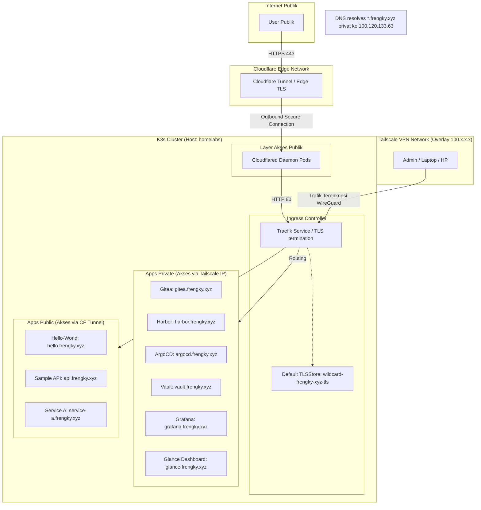

# Dokumentasi Infrastruktur Kluster K3s (Homelab frengky.xyz)
 
> **Cara pakai dokumen ini:** Dokumen ini dirancang sebagai *living document*, perbarui setiap kali ada perubahan topologi, node baru, atau aplikasi baru di kluster.
 
---
 
## 0. Daftar Isi
 
1. Ringkasan Arsitektur
2. Topologi Jaringan
3. Struktur Node & Kluster K3s
4. Model Akses Aplikasi (Privat vs Publik)
5. Akses Privat — Khusus via Tailscale (DNS-Only Gray Cloud)
6. Akses Publik — Internet-facing via Cloudflare Tunnel
7. DNS & TLS/Sertifikat
8. Struktur Namespace & Deployment Aplikasi
9. GitOps / CI-CD
10. Keamanan & Hardening
11. Contoh Manifest YAML Aktual
12. Diagram Arsitektur
13. Runbook / Checklist Operasional
14. Lampiran — Inventaris Aplikasi Aktual
---
 
## 1. Ringkasan Arsitektur
 
| Item | Detail |
|---|---|
| Nama proyek/cluster | `homelabs` (frengky.xyz Homelab) |
| Distribusi Kubernetes | K3s versi `v1.36.2+k3s1` |
| Jumlah node | `1` (1 server / control-plane, 0 agent/worker) |
| Provider/hosting | `Homelab WSL2 (Windows Host, Ubuntu 26.04 LTS)` |
| CNI (Container Network Interface) | `Flannel (default k3s)` |
| Ingress Controller | `Traefik (default k3s)` |
| Load Balancer internal | `ServiceLB (Klipper)` |
| VPN mesh | `Tailscale` |
| Reverse proxy publik | `Cloudflare Tunnel (cloudflared)` |
| Sertifikat TLS | `cert-manager (v1.15.1) + Let's Encrypt (DNS-01 Challenge via Cloudflare API)` |
| GitOps | `ArgoCD (App of Apps pattern)` |
| Storage | `local-path (local-path-provisioner)` |
| Secret Management | `HashiCorp Vault + External Secrets Operator (ESO)` |
 
### Prinsip desain akses
Cluster ini menerapkan **dua jalur akses berbeda** untuk aplikasi:
 
1. **Privat / internal-only** → Hanya bisa diakses oleh perangkat yang tergabung dalam **tailnet** (jaringan Tailscale), tidak terekspos ke internet publik sama sekali.
2. **Publik** → Aplikasi memang ditujukan untuk diakses umum, diekspos lewat ingress + reverse proxy publik (Cloudflare Tunnel) dengan TLS yang valid.
 
Pemisahan ini dilakukan di level **DNS & Ingress/Service**, bukan di level node, sehingga satu cluster yang sama bisa menjalankan kedua jenis aplikasi secara berdampingan dengan aman.
 
---
 
## 2. Topologi Jaringan
 
Ada **4 layer jaringan** yang bekerja pada kluster homelab:
 
### 2.1 Physical/Local Network (Underlay)
- Jaringan lokal WSL2 di komputer host, mendapatkan alokasi IP lokal.
- Node utama: `homelabs: 192.168.100.6`
### 2.2 Tailscale Network (Overlay VPN — Tailnet)
- Setiap node k3s, dan setiap perangkat admin (laptop `frengky-sre`, HP `realme-c67`), terpasang `tailscaled` dan tergabung ke tailnet `tail79205d.ts.net`.
- Tailscale memberi node host **IP CGNAT 100.x.x.x** (Tailscale IP) yang stabil dan terenkripsi (WireGuard).
- **MagicDNS** aktif sehingga node bisa diakses dengan hostname `homelabs.tail79205d.ts.net`.
| Node | Tailscale IP | Tailscale Hostname | Tags |
|---|---|---|---|
| `homelabs` | `100.120.133.63` | `homelabs.tail79205d.ts.net` | `tag:k3s-server` |
 
> **Catatan:** Trafik k3s API server (port 6443) hanya listen pada IP Tailscale dan localhost, sehingga tidak terekspos ke jaringan publik komputer host.
 
### 2.3 Kubernetes Pod Network (CNI Overlay)
- Diatur oleh Flannel, default CIDR: `10.42.0.0/16`
- Pod-to-pod communication antar container diatur secara internal oleh CNI overlay.
### 2.4 Kubernetes Service Network (ClusterIP)
- CIDR default: `10.43.0.0/16`
- Internal-only, hanya bisa diakses dari dalam cluster (kecuali diekspos lewat Ingress/NodePort/LoadBalancer).
### 2.5 Ringkasan Layer
 
```
[Internet Publik]
       │
       ▼
[Cloudflare Tunnel] (Proxied via cloudflared) ← Hanya untuk aplikasi publik
       │
       ▼
[Local/WSL Network — IP 192.168.100.6]
       │
       ├── Tailscale overlay (100.120.133.63) ← Akses admin & aplikasi privat (Gray Cloud DNS)
       │
       ▼
[K3s Cluster]
  ├── Pod Network   (10.42.0.0/16)
  └── Service Network (10.43.0.0/16)
```
 
---
 
## 3. Struktur Node & Kluster K3s
 
### 3.1 Peran Node
 
| Role | Node | OS | Spek | Catatan |
|---|---|---|---|---|
| Server (control-plane + etcd) | `homelabs` | `Ubuntu 26.04 LTS (WSL2)` | `8 Cores / 16GB / 512GB (Dynamic)` | Single-node, HA: tidak |
 
### 3.2 Instalasi K3s dengan Tailscale sebagai jaringan node-to-node
 
Untuk instalasi single-node dengan interface Tailscale, digunakan flag `--node-ip` dan `--flannel-iface` agar k3s berjalan di atas interface Tailscale (`tailscale0`).
 
```bash
# Di node server (control-plane)
curl -sfL https://get.k3s.io | sh -s - server \
  --node-ip=100.120.133.63 \
  --flannel-iface=tailscale0 \
  --tls-san=homelabs.tail79205d.ts.net
```
 
> Dengan konfigurasi ini, **API server k3s (port 6443) hanya listen/reachable lewat Tailscale IP dan Localhost**, bukan IP publik host.
 
### 3.3 Namespace Standar
 
| Namespace | Fungsi |
|---|---|
| `kube-system` | Komponen inti k3s (CoreDNS, Traefik, local-path-provisioner, metrics-server) |
| `argocd` | GitOps controller (ArgoCD) |
| `cert-manager` | Manajemen sertifikat TLS (cert-manager) |
| `external-secrets` | Sinkronisasi secret dari Vault ke Kubernetes Secrets (ESO) |
| `vault` | Penyimpanan rahasia utama (HashiCorp Vault) |
| `harbor` | Docker/Helm Registry lokal (Harbor) |
| `cloudflare` | Daemon Cloudflare Tunnel (`cloudflared`) |
| `gitea` | Git repository provider lokal (Gitea) |
| `gitea-runner` | Runner CI/CD untuk otomatisasi pipeline (Gitea Actions Runner) |
| `monitoring` | Komponen observabilitas (Grafana, Loki, Alloy, VictoriaMetrics, node-exporter, kube-state-metrics) |
| `frontend` | Aplikasi sisi pengguna akhir (`hello-world`, `glance` dashboard) |
| `backend` | API backend (`sample-api`) |
| `production` | Deployment aplikasi untuk lingkungan production (`service-a`) |
| `staging` | Deployment aplikasi untuk lingkungan staging (`service-a-staging`) |
| `argo-rollouts` | Controller untuk deployment canary/bluegreen (`argo-rollouts`) |
 
---
 
## 4. Model Akses Aplikasi
 
Setiap aplikasi baru dideploy mengikuti bagan keputusan ini:
 
```mermaid
flowchart TD
    A[Aplikasi baru mau di-deploy] --> B{Perlu diakses publik?}
    B -- Tidak, hanya admin/tim --> C[Akses via Tailscale saja]
    B -- Ya, untuk pengguna umum --> D[Akses via Ingress Publik]
    C --> E[DNS Cloudflare Gray Cloud\n-> Point ke Tailscale IP 100.120.133.63\n+ Ingress Traefik + cert-manager TLS]
    D --> F[DNS Cloudflare Orange Cloud (Proxied)\n-> Cloudflare Tunnel + Ingress Traefik]
```
 
| Kriteria | Privat (Tailscale-only) | Publik (Internet-facing) |
|---|---|---|
| Contoh aplikasi | Gitea, Harbor, ArgoCD, Vault, Grafana, Glance Dashboard, Argo Rollouts | Hello World, Sample API, Service A, Service A Staging |
| Service type | `ClusterIP` | `ClusterIP` (diekspos via Ingress) |
| Exposure | DNS Gray Cloud -> IP Tailscale `100.120.133.63` -> Traefik Ingress | Cloudflare Tunnel -> `cloudflared` deployment -> Traefik Ingress |
| TLS | cert-manager + Let's Encrypt (DNS-01 Wildcard `*.frengky.xyz`) | Otomatis via Cloudflare Edge TLS / Let's Encrypt |
| DNS | DNS Publik Gray Cloud (`app.frengky.xyz` -> `100.120.133.63`) | DNS Publik Orange Cloud (`app.frengky.xyz` -> Cloudflare CNAME) |
| Firewall | Port 80/443 hanya dapat dijangkau oleh perangkat dalam Tailnet | Port VPS tidak dibuka; koneksi keluar via Cloudflare Tunnel |
 
---
 
## 5. Akses Privat — Khusus via Tailscale (DNS-Only Gray Cloud)
 
Kluster ini mengimplementasikan pola **Private Custom Domain via Tailscale IP + DNS-01 Challenge**. 
 
```
[Device dengan Tailscale] ──► DNS Query `grafana.frengky.xyz` ──► Mengembalikan `100.120.133.63`
                                                                    │
    ┌───────────────────────────────────────────────────────────────┘
    ▼
[Host Homelabs (Port 443)] ──► Traefik ──► Menyajikan Wildcard Cert `*.frengky.xyz` ──► Grafana Pod
```
 
### 5.1 Alur Kerja Akses Privat
1. **Domain DNS Publik**: Domain `*.frengky.xyz` didefinisikan di Cloudflare. Subdomain untuk tool privat diset sebagai **DNS-Only (Gray Cloud)** dan diarahkan ke IP Tailscale Host: `100.120.133.63`.
2. **Keamanan**: Perangkat luar tailnet tidak akan bisa menghubungi IP `100.120.133.63` karena IP CGNAT Tailscale hanya dapat dirutekan di dalam mesh network Tailscale.
3. **Enkripsi SSL/TLS**: Karena trafik tidak lewat Edge Proxy Cloudflare, sertifikat TLS di-terminate langsung di Traefik. Sertifikat wildcard valid diterbitkan oleh `cert-manager` menggunakan **Let's Encrypt DNS-01 Challenge** via API Cloudflare.
 
---
 
## 6. Akses Publik — Internet-facing via Cloudflare Tunnel
 
Aplikasi publik (seperti `api.frengky.xyz`, `hello.frengky.xyz`, `service-a.frengky.xyz`) diekspos menggunakan Cloudflare Tunnel. Pola ini memastikan kluster homelab aman tanpa perlu membuka port port inbound (seperti 80/443) pada IP publik komputer host.
 
### 6.1 Alur Kerja Akses Publik
1. **Cloudflared Daemon**: Pod `cloudflared` di namespace `cloudflare` membuat koneksi keluar (*outbound*) secara aman ke edge network Cloudflare menggunakan `TUNNEL_TOKEN`.
2. **Routing Inbound**: Cloudflare merutekan request subdomain publik ke pod `cloudflared` di dalam kluster.
3. **Ingress Controller**: Pod `cloudflared` meneruskan trafik secara internal ke Traefik Ingress Controller di `kube-system`. Traefik kemudian mengarahkan request ke Service aplikasi yang tepat berdasarkan header `Host`.
 
---
 
## 7. DNS & TLS/Sertifikat
 
| Skema Akses | Domain | DNS Provider/Resolver | TLS Certificate |
|---|---|---|---|
| **Privat** | `*.frengky.xyz` (seperti `argocd.`, `vault.`, `grafana.`, `harbor.`, `gitea.`, `glance.`) | Cloudflare (Gray Cloud) -> IP Tailscale `100.120.133.63` | cert-manager + Let's Encrypt Wildcard TLS (`wildcard-frengky-xyz-tls`) |
| **Publik** | `*.frengky.xyz` (seperti `hello.`, `api.`, `service-a.`) | Cloudflare (Orange Cloud) -> CNAME Cloudflare Tunnel | Cloudflare Edge TLS / Let's Encrypt |
 
### 7.1 Konfigurasi cert-manager & Let's Encrypt DNS-01
 
Karena pod kluster mengalami kendala *outbound egress timeout* ke internet, pod `cert-manager` dipatch menggunakan **Host Network Workaround** agar bisa menghubungi server ACME Let's Encrypt secara langsung dari network namespace host:
 
- `hostNetwork: true`
- `dnsPolicy: ClusterFirstWithHostNet`
 
---
 
## 8. Struktur Namespace & Deployment Aplikasi
 
Seluruh deployment dikelola secara terpusat di repositori GitOps Gitea lokal (`http://gitea-http.gitea.svc.cluster.local:3000/devops/gitops.git`).
 
### Struktur Folder Repositori GitOps:
```
gitops-repo/
├── kubernetes/
│   ├── applications/              # Definisi Aplikasi ArgoCD (App of Apps Pattern)
│   │   ├── root-app.yaml          # Entry point utama ArgoCD (App-of-Apps)
│   │   ├── infrastructure/        # Manifest aplikasi infrastruktur dasar
│   │   │   ├── vault.yaml, argocd.yaml, cert-manager.yaml, gitea.yaml, harbor.yaml, dll.
│   │   ├── production/            # Manifest aplikasi production
│   │   │   ├── glance.yaml, sample-api.yaml, hello-world.yaml, service-a.yaml, dll.
│   │   └── staging/               # Manifest aplikasi staging
│   │       └── service-a.yaml
│   │
│   ├── infrastructure/            # Kustomisasi/Install component infrastruktur non-production
│   │   └── argo-rollouts/
│   │
│   ├── production/                # Konfigurasi Helm Values & Manifest per aplikasi production
│   │   ├── argocd/, vault/, gitea/, harbor/, cloudflare/, cert-manager/, dll.
│   │   ├── frontend/
│   │   │   ├── glance/            # Values, templates, dan Chart.yaml Glance Dashboard
│   │   │   └── hello-world/       # Values dan Chart.yaml Hello-World
│   │   └── backend/
│   │       └── sample-api/        # Values dan Chart.yaml Go-based Sample API
│   │
│   ├── staging/                   # Konfigurasi Helm Values staging
│   │   └── service-a/
│   │
│   └── secrets/                   # Templating ESO & dokumentasi Secret Integration
└── README.md
```
 
---
 
## 9. GitOps / CI-CD
 
| Item | Detail |
|---|---|
| GitOps Engine | `ArgoCD` |
| Repository Sumber | `http://gitea-http.gitea.svc.cluster.local:3000/devops/gitops.git` |
| Remote Publik/Backup | `https://gitea.frengky.xyz/devops/gitops.git`, `https://gitlab.frengky.xyz/frengky/gitops.git` |
| Strategi Sync | `Auto-Sync dengan Prune & Self-Heal` |
| Environment | `Staging` (namespace: `staging`), `Production` (namespace: `production`, `backend`, `frontend`) |
| Secret Management | `HashiCorp Vault` terintegrasi dengan `External Secrets Operator (ESO)` |
 
---
 
## 10. Keamanan & Hardening
 
- [x] **API Server Isolation**: K3s API server (port 6443) hanya dapat diakses melalui interface Tailscale (`100.120.133.63`) and localhost. Port 6443 tidak terekspos ke internet.
- [x] **Zero-Ports Inbound for Public**: Pengiklanan aplikasi publik menggunakan Cloudflare Tunnel, sehingga port 80 dan 443 pada host tidak perlu dibuka ke publik.
- [x] **SSL/TLS Default Store**: Traefik dikonfigurasi menggunakan custom `TLSStore` default (`wildcard-frengky-xyz-tls`) di namespace `kube-system` sehingga seluruh ingress secara otomatis menyajikan sertifikat SSL valid.
- [x] **Secret Externalization**: Tidak ada berkas rahasia (seperti API token, password database) yang disimpan di Git. Semua ditarik secara dinamis dari Vault oleh ESO menggunakan CRD `ExternalSecret`.
- [x] **Network Policy / Namespace Isolation**: Ingress dikonfigurasi per namespace untuk mengisolasi traffic secara logis.
 
---
 
## 11. Contoh Manifest YAML Aktual
 
### 11.1 ClusterIssuer (Let's Encrypt DNS-01 via Cloudflare)
```yaml
apiVersion: cert-manager.io/v1
kind: ClusterIssuer
metadata:
  name: letsencrypt-prod
spec:
  acme:
    server: https://acme-v02.api.letsencrypt.org/directory
    email: frengky@frengky.xyz
    privateKeySecretRef:
      name: letsencrypt-prod-issuer-key
    solvers:
      - dns01:
          cloudflare:
            apiTokenSecretRef:
              name: cloudflare-api-token-secret
              key: api-token
```
 
### 11.2 Certificate Wildcard (*.frengky.xyz)
```yaml
apiVersion: cert-manager.io/v1
kind: Certificate
metadata:
  name: wildcard-frengky-xyz
  namespace: kube-system
spec:
  secretName: wildcard-frengky-xyz-tls
  issuerRef:
    name: letsencrypt-prod
    kind: ClusterIssuer
  commonName: "*.frengky.xyz"
  dnsNames:
    - "*.frengky.xyz"
    - "frengky.xyz"
```
 
### 11.3 Traefik Default TLS Store
```yaml
apiVersion: traefik.io/v1alpha1
kind: TLSStore
metadata:
  name: default
  namespace: kube-system
spec:
  defaultCertificate:
    secretName: wildcard-frengky-xyz-tls
```
 
### 11.4 Ingress untuk Aplikasi Privat (Grafana)
```yaml
apiVersion: networking.k8s.io/v1
kind: Ingress
metadata:
  name: grafana
  namespace: monitoring
spec:
  ingressClassName: traefik
  rules:
    - host: grafana.frengky.xyz
      http:
        paths:
          - path: /
            pathType: Prefix
            backend:
              service:
                name: grafana
                port:
                  number: 80
```
 
### 11.5 ExternalSecret Integration (Mengambil secret dari Vault)
```yaml
apiVersion: external-secrets.io/v1beta1
kind: ExternalSecret
metadata:
  name: sample-api-secrets
  namespace: backend
spec:
  refreshInterval: 1h
  secretStoreRef:
    name: vault-backend
    kind: SecretStore
  target:
    name: sample-api-secret
    creationPolicy: Owner
  data:
    - secretKey: APP_ENV
      remoteRef:
        key: secret/data/production/backend/sample-api
        property: APP_ENV
```
 
---
 
## 12. Diagram Arsitektur (Mermaid)
 

 
---
 
## 13. Runbook / Checklist Operasional
 
**Menambah aplikasi privat baru:**
1. Deploy Deployment + Service (`ClusterIP`) di namespace tujuan.
2. Buat file Ingress dengan `ingressClassName: traefik` dan masukkan domain `app-baru.frengky.xyz`.
3. Simpan Secret aplikasi ke Vault: `vault kv put secret/production/<namespace>/<app-baru> key=value`.
4. Buat manifest `ExternalSecret` untuk menyinkronkan rahasia ke Kubernetes Secret.
5. Daftarkan **A Record DNS-Only (Gray Cloud)** di Cloudflare Dashboard untuk `app-baru.frengky.xyz` -> mengarah ke IP Tailscale Host `100.120.133.63`.
6. Uji akses via browser di perangkat yang terhubung ke Tailscale: `https://app-baru.frengky.xyz`.
 
**Menambah aplikasi publik baru:**
1. Deploy Deployment + Service (`ClusterIP`) di namespace tujuan.
2. Buat file Ingress dengan `ingressClassName: traefik` dan masukkan domain `public-app.frengky.xyz`.
3. Konfigurasikan route DNS di **Cloudflare Dashboard (Tunnels)** untuk mengarahkan `public-app.frengky.xyz` secara internal ke `http://traefik.kube-system.svc.cluster.local:80` atau Service aplikasi secara langsung.
4. Verifikasi status sinkronisasi di ArgoCD dan pastikan pod status `Running`.
5. Uji akses dari jaringan luar (misal: jaringan internet seluler) ke `https://public-app.frengky.xyz`.
 
**Insiden/Debug Kendala DNS Let's Encrypt:**
1. Jika sertifikat Let's Encrypt gagal terverifikasi, cek log dari pod cert-manager:
   ```bash
   kubectl logs -n cert-manager -l app.kubernetes.io/name=cert-manager --tail=100
   ```
2. Pastikan rahasia API Token Cloudflare valid:
   ```bash
   kubectl describe secret cloudflare-api-token-secret -n cert-manager
   ```
3. Pastikan pod `cert-manager` berjalan di host network:
   ```bash
   kubectl get pod -n cert-manager -o wide
   ```
 
---
 
## 14. Lampiran — Inventaris Aplikasi Aktual
 
| Aplikasi | Namespace | Kategori | URL Akses (HTTPS) | Deskripsi / Catatan |
|---|---|---|---|---|
| **ArgoCD** | `argocd` | Privat | `https://argocd.frengky.xyz` | Dashboard GitOps Engine |
| **Gitea** | `gitea` | Privat | `https://gitea.frengky.xyz` | Repository Git lokal (source-of-truth) |
| **Harbor** | `harbor` | Privat | `https://harbor.frengky.xyz` | Image registry lokal untuk base & runner images |
| **Vault** | `vault` | Privat | `https://vault.frengky.xyz` | Credential & Secret Management |
| **Grafana** | `monitoring` | Privat | `https://grafana.frengky.xyz` | Metrik visualisasi (VictoriaMetrics/Loki) |
| **Glance** | `frontend` | Privat | `https://glance.frengky.xyz` | Personal homepage & homelab dashboard |
| **Argo Rollouts** | `argo-rollouts` | Privat | `https://rollouts.frengky.xyz` | Dashboard manajemen canary/blue-green deployments |
| **Traefik Dashboard** | `kube-system` | Privat | `https://traefik.frengky.xyz/dashboard/` | Ingress proxy traffic router dashboard |
| **Hello World** | `frontend` | Publik | `https://hello.frengky.xyz` | Contoh deployment web frontend statis |
| **Sample API** | `backend` | Publik | `https://api.frengky.xyz` | REST API berbasis Go (backend sample) |
| **Service A (Prod)** | `production` | Publik | `https://service-a.frengky.xyz` | Aplikasi Service-A Production |
| **Service A (Staging)** | `staging` | Publik | `https://service-a-staging.frengky.xyz` | Aplikasi Service-A Staging |
| **Loki** | `monitoring` | Internal | - | Log aggregation engine (VictoriaMetrics backend) |
| **Alloy** | `monitoring` | Internal | - | Agent pengumpul logs/metrics |
| **VictoriaMetrics** | `monitoring` | Internal | - | TSDB metrics engine |
